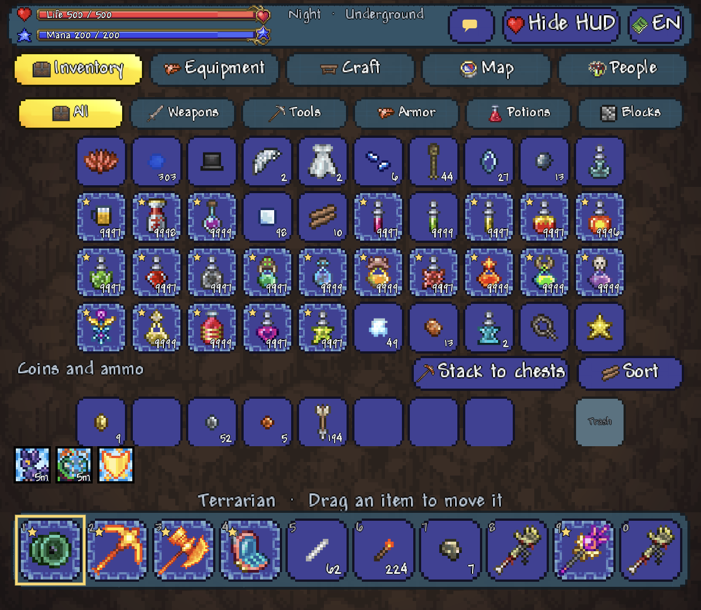
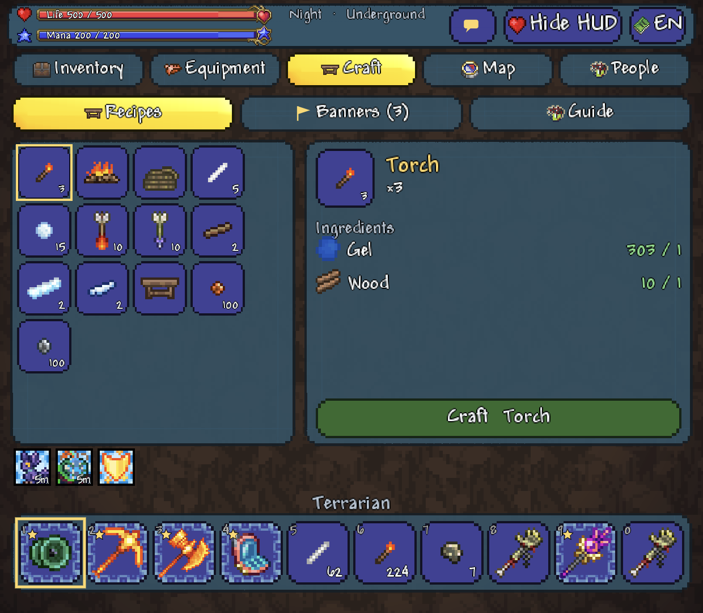
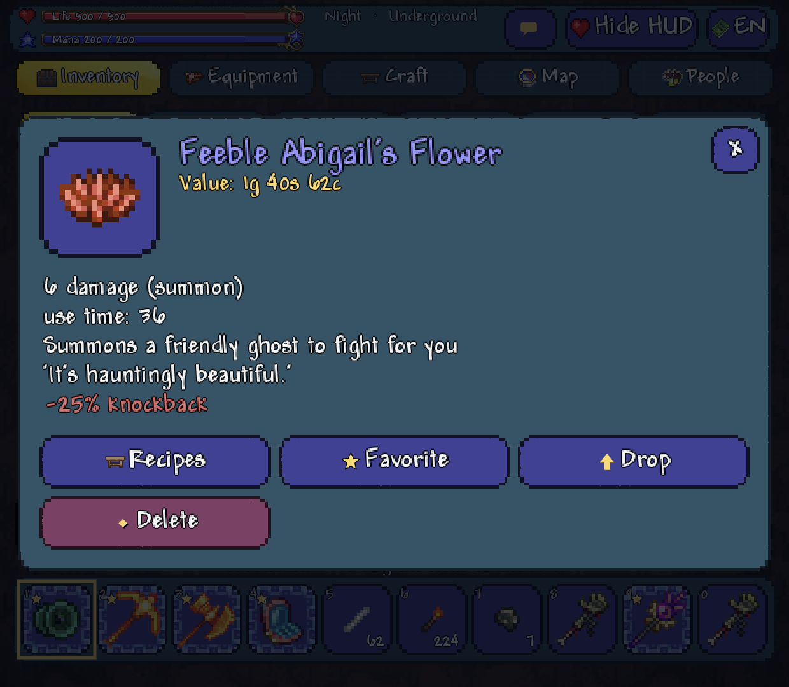
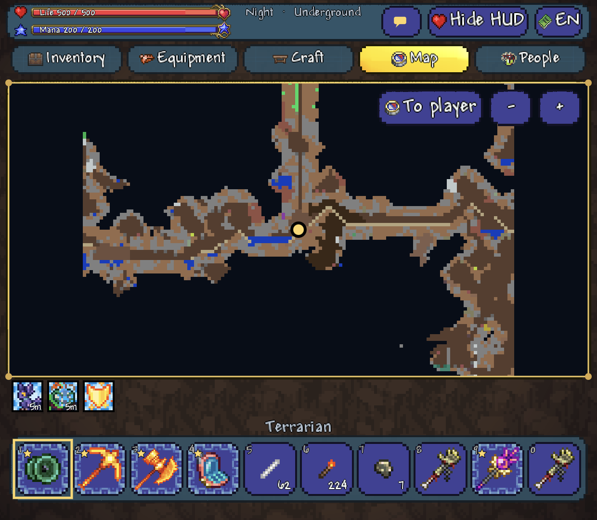
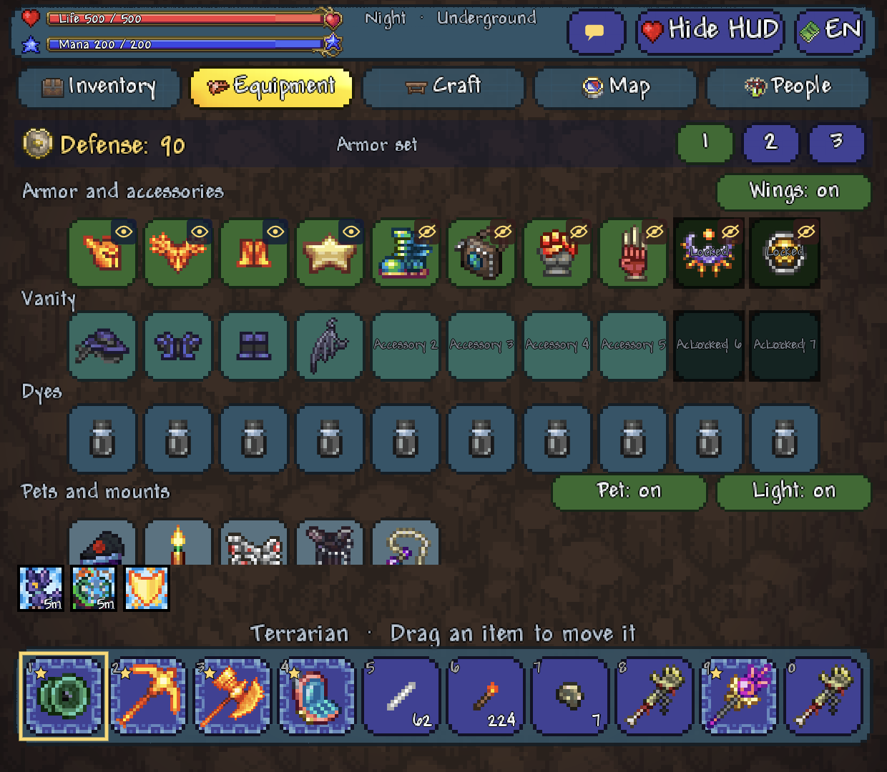
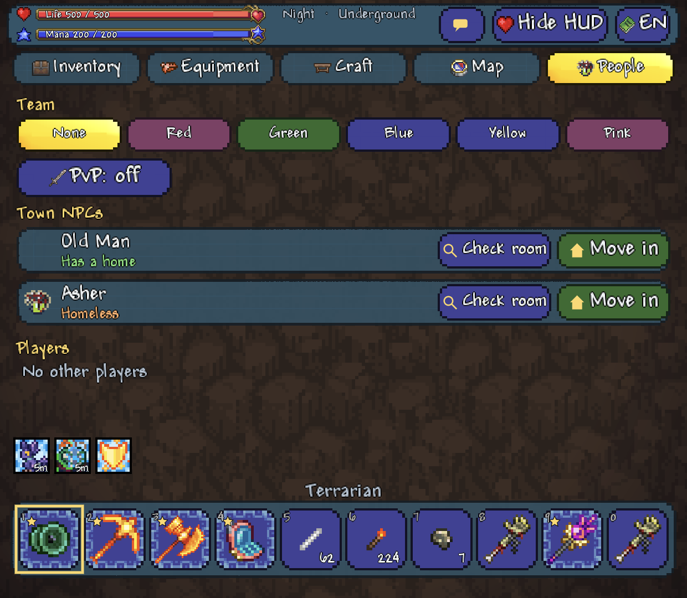
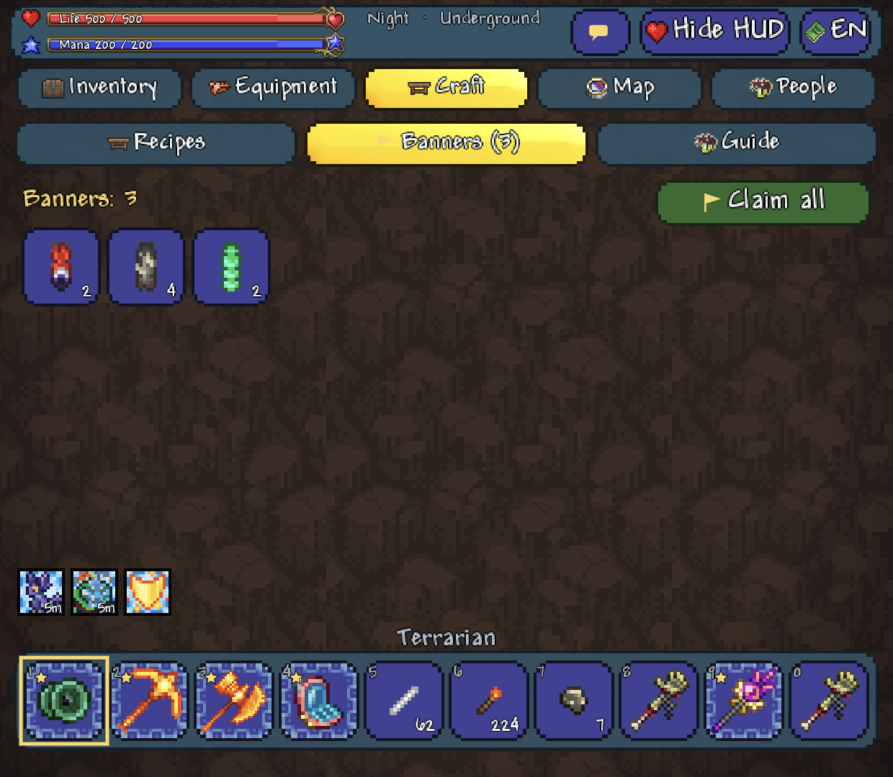
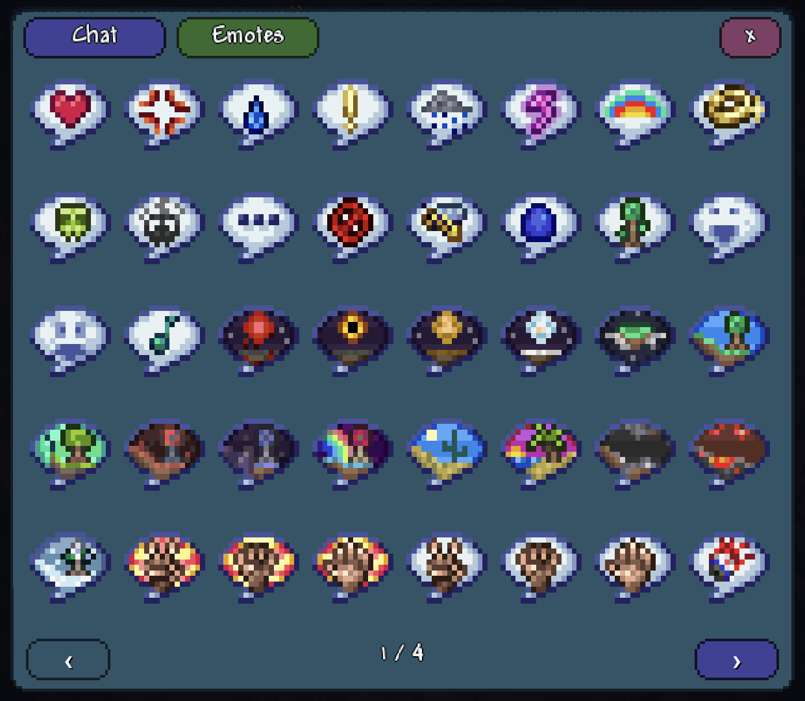

# Terraria Dual Screen Companion

**A second-screen companion for Terraria on dual-screen Android devices (built and tested on the AYN Thor).**
Terraria runs on the top screen as usual. The bottom screen becomes a live, touch-controlled panel — inventory, equipment,
crafting, chests, buffs, map and a background that follows where you are — built from the *real* game state.

[Русская версия](README_RU.md) · [User guide](docs/GUIDE_EN.txt) · [Contributing](CONTRIBUTING.md) · [Architecture](docs/ARCHITECTURE.md)

> **Status:** works in single-player through [TL Pro](https://play.google.com/store/apps/details?id=com.pixelcurves.terlauncher).
> Early but usable. Help is very welcome — see [Contributing](CONTRIBUTING.md) and the open issues.

<p align="center">
  
  
</p>
<p align="center">
  
  
</p>
<p align="center">
  
  
</p>
<p align="center">
  
  
</p>

## What it does

- **Inventory** — all slots, coins, ammo, trash slot, sort. Drag to move, swap or stack; double-tap a stack to split it.
- **Item window** — big sprite, rarity colour, stats, the game's own tooltip, reforge percentages, context buttons
  (Use, Equip, Favourite, Split, Drop, Delete, Put in chest, Take).
- **Edge gestures while dragging** — top: drop · bottom: use / equip / summon · right: trash · left: favourite.
- **Equipment, crafting, chests and banks**, hotbar, health and mana bars (tap to flip to hearts and stars), buffs and debuffs,
  info accessories (watch, depth meter, compass, weather radio).
- **People** — team and PvP, town NPCs with a room check / move-in, armour sets (loadouts) and total defence.
- **Chat and emotes** — the game's chat log with an on-screen keyboard (EN / RU, slash commands) and all 151 emote bubbles.
- **Nearby** — talk to (and trade with) any town NPC close to you, and look up recipes with the Guide on the second screen.
- **Banners** — claim earned banners from the Craft tab; buffs and pets can be tapped, accessory / armour / wings visibility toggled.
- **Map** with smooth panning and pinch zoom, town NPC heads, boss icons with health.
- **Hide HUD** removes the game's own HUD from the top screen; the controller then drives the companion
  (L1 / R1 hotbar, Y cycles the tabs).
- **Backgrounds from the game itself** — your biome's parallax layers, cave wall textures, day / night tint, clouds,
  rain and snow, lightning flashes, damage / heal / mana edge flashes, the game's interface sounds.
- English, Russian, Spanish and Polish.

Everything is drawn from the game's own sprites, fonts and backgrounds, decoded **on your PC from your own installed copy**
(see [Legal](#legal)). No OCR, no fake data, no virtual taps: the game stays the authority and changes happen only through
its own routines.

## How it works

```
Terraria (top screen)  <──  TL Pro mod (JavaScript, src/tlpro)  ──TCP 127.0.0.1:38656──>  Companion app (Java, src/companion)
   real game state          reads state, runs game routines                                  draws the bottom screen
```

The mod runs inside TL Pro's JavaScript runtime and talks to the game through the IL2CPP bindings; the app polls it over
loopback and renders everything on one canvas. Details: [docs/ARCHITECTURE.md](docs/ARCHITECTURE.md).

## Quick start

1. Install Terraria (Google Play) and TL Pro. Back up your saves.
2. Install the APK from the [Releases](../../releases) page (it is signed with a development key).
3. Import `Terraduo-Companion-mod-*.tl` in TL Pro and enable the pack. Restart the game through TL Pro after every mod update.
4. Prepare the sprites once on a PC (`tools/extract_assets.py`, `tools/extract_backgrounds.py` — see the
   [guide](docs/GUIDE_EN.txt), step 4).
5. Start a single-player world, open **Terraduo Companion** — it opens on the bottom screen by itself.

## Building

```
python tools/make_icon.py          # optional: redraw the launcher icon
python tools/build.py              # builds build/terraduo-companion.apk (development key)
python tools/build_tlpro.py        # builds build/terraduo-hotbar.tl (the TL Pro mod pack)
```

You need a JDK (`JAVA_HOME`), the Android SDK (`ANDROID_SDK_ROOT`, build-tools and platform `android-33`) and Python 3.10+.
See [BUILD.md](BUILD.md).

## Repository layout

| Path | What |
|---|---|
| `src/companion` | Android app (plain Java, no Gradle, `javac` + `d8` + `aapt2`) |
| `src/tlpro` | the TL Pro mod pack (JavaScript) |
| `tools` | build scripts, sprite / background extractors, dev helpers |
| `docs` | architecture notes, user guide and description (EN / RU), screenshots |

## Contributing

Bug reports, ideas, device reports and pull requests are all welcome — see [CONTRIBUTING.md](CONTRIBUTING.md).
Good first areas: NPC dialogue and shop actions, underground backgrounds, the player head marker on the map,
other dual-screen devices, translations, tests.

## Legal

- **No game assets are in this repository or in the releases.** Sprites, fonts and backgrounds are decoded locally from the
  copy of Terraria you installed and stay on your devices. Please do not redistribute them.
- The project does **not** remove, bypass or weaken any licence check or protection and never modifies or re-signs the game APK.
  Do not use it with cracked copies; issues that involve them will be closed.
- Single-player only. Not for online servers.
- Terraria is a trademark of Re-Logic. This project is unofficial and not affiliated with or endorsed by Re-Logic or the TL Pro
  developers. The few screenshots in `docs/screenshots` show the game's art for illustration only.
- Code: [MIT License](LICENSE).
